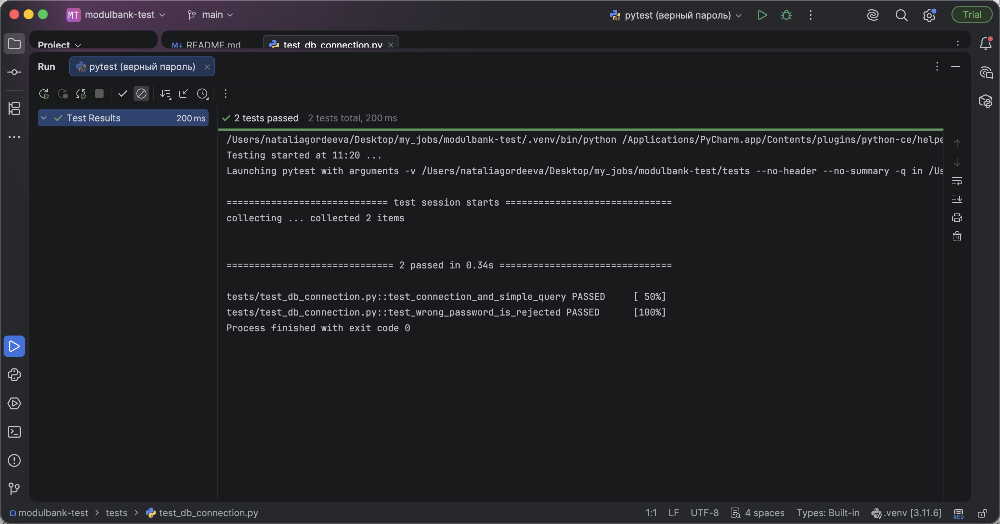
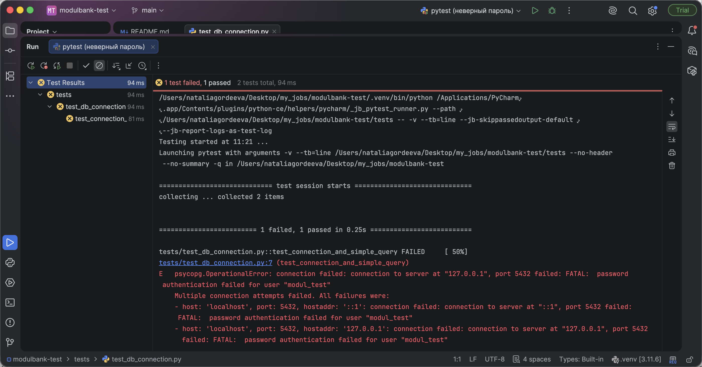

# Тестовое задание. Базы данных и SQL

| Часть | Файл |
|---|---|
| 1. Теория | [theory.md](theory.md) |
| 2. SQL-задачи | [sql/02_tasks.sql](sql/02_tasks.sql), схема и тестовые данные в [sql/01_schema.sql](sql/01_schema.sql) |
| 3. Автотест подключения | [tests/test_db_connection.py](tests/test_db_connection.py), [tests/conftest.py](tests/conftest.py) |

СУБД PostgreSQL 15 (в задании разрешен вместо Oracle и SQL Server), Python 3.11, pytest, драйвер psycopg 3, IDE PyCharm.

## Запуск

```bash
# база
createuser -P modul_test          # пароль задать свой
createdb -O modul_test modul_test
psql -h localhost -U modul_test -d modul_test -f sql/01_schema.sql
psql -h localhost -U modul_test -d modul_test -f sql/02_tasks.sql

# окружение
python3 -m venv .venv
.venv/bin/pip install -r requirements.txt
cp .env.example .env              # вписать DB_PASSWORD

# тесты
.venv/bin/pytest -v
```

В PyCharm надо выбрать `.venv` как интерпретатор и запустить `tests` через pytest.

## Что проверяют тесты

1. `test_connection_and_simple_query` подключается к базе, выполняет `select now()` и проверяет, что вернулось время, близкое к текущему.
2. `test_wrong_password_is_rejected` подключается с заведомо неверным паролем и ожидает `OperationalError`.

Параметры подключения берутся из переменных окружения (`DB_HOST`, `DB_PORT`, `DB_NAME`, `DB_USER`, `DB_PASSWORD`) или из `.env`, поэтому пароль в коде не хранится.

## Демонстрация

Прогон из PyCharm, конфигурации pytest с верным и неверным паролем.





Тот же прогон из терминала. Успешный, лог в `run_ok.log`.

```
tests/test_db_connection.py::test_connection_and_simple_query PASSED
tests/test_db_connection.py::test_wrong_password_is_rejected PASSED
2 passed
```

Прогон с неверным паролем (`DB_PASSWORD=wrong pytest -v`), лог в `run_bad_password.log`.

```
FAILED tests/test_db_connection.py::test_connection_and_simple_query
psycopg.OperationalError: ... FATAL:  password authentication failed for user "modul_test"
1 failed, 1 passed
```

По умолчанию локальный PostgreSQL из Homebrew пускает подключения с localhost без пароля (метод `trust` в `pg_hba.conf`). При такой настройке тест с неверным паролем проходит, хотя должен падать. Для тестовой базы в `pg_hba.conf` включена проверка пароля `scram-sha-256`.

```
host    modul_test      modul_test      127.0.0.1/32            scram-sha-256
host    modul_test      modul_test      ::1/128                 scram-sha-256
```
